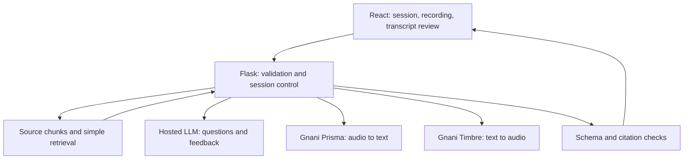

# RepoViva — Proposed Architecture

Original design: version 0.3, October 30, 2026 (IST). Read with [PRD.md](PRD.md), [readme.md](readme.md) and [trd.md](trd.md). The roadmap below is historical; current persistence is documented in [POSTGRES.md](POSTGRES.md).

**Implemented November 10:** Flask uses psycopg 3 connection pooling and versioned
SQL migrations for PostgreSQL users, hashed login sessions, extracted sources,
practice sets, turns and scored attempts. Queries enforce verified Google
ownership. One source is active per identity; replacement archives old sources,
while explicit removal cascades to linked practice. The current-source API
restores public questions and submitted feedback/answers after reload, and
`GET /history` exposes owned attempts. Configured database failures return 503;
only a blank `DATABASE_URL` selects temporary memory development storage.
Production startup migrates before Gunicorn. The remaining sections describe the
original learning plan rather than the complete current implementation.

## 1. Core design

Build a small evidence-grounded interview tool. A model receives bounded source excerpts and produces questions and coaching feedback. The backend owns source selection, session state and citation validation. The model is not the source of truth about the repository.

Three labels describe a candidate's implementation claims:

- **Supported:** supplied evidence supports the claim.
- **Contradicted:** supplied evidence directly conflicts with the claim.
- **Unverified:** evidence is missing, ambiguous or insufficient.

Missing retrieval results must never automatically become a contradiction. Evidence-backed feedback is a model judgment with inspectable sources, not a proof system.

## 2. Smallest end-to-end version

Begin with a CLI source loader. Later, wrap evidence selection and evaluation in Flask and add a small React + Vite interface. First use typed answers, then add voice through provider adapters. Every layer should run independently before the layers are joined.

The diagram shows responsibilities, not a claim that every component runs on every request. No direct browser-to-provider key exposure.

## 3. Technology decisions

| Layer | Proposed choice | Reason and trade-off |
| --- | --- | --- |
| First exercise | Python standard library | Learn source reading and line references before framework setup |
| Backend | Python + Flask | User-preferred Python API framework; explicit Python functions validate request and model response dictionaries |
| Frontend | React + Vite + TypeScript | Typed component props and client/server contracts; Flask owns business logic |
| Source input | Bundled, sanitized text source pack | Deterministic, inspectable demo; arbitrary GitHub ingestion adds unrelated complexity |
| Retrieval | Fixed line chunks, initial feature map, then simple keyword ranking | Learn a small RAG pipeline in Python without embeddings or a vector database |
| Reasoning | One existing hosted LLM account, one provider adapter | Avoid building a key scheduler; model and quota verified when implementing |
| Voice | Prisma STT + Timbre TTS adapters | Real Gnani use in the demonstrated pipeline; test actual account availability early |
| Session storage | In memory for the first demo | Simple; sessions disappear on restart and cannot span independent workers |
| Deployment | One backend process + one frontend deployment | Matches storage assumptions; no multiworker deployment until storage changes |

The original demo deferred PostgreSQL. It is now implemented for restart recovery
and saved study progress; see the current note above. Redis, a vector database,
graph database, agent framework and task queue remain outside this design.

Use a small Python provider adapter for each external HTTP API; verify its official contract at implementation time. Validate required strings, lists, allowed labels and citation fields with explicit Python functions. A valid JSON parse does not establish a valid schema. Use Flask multipart upload handling with a server-side upload-size limit and request cleanup. Keep dependencies in `backend/requirements.txt` and install them in `.venv`; no mandatory Pydantic, LangChain or LlamaIndex.

Use one Flask process. Since request handling may use threads, protect shared session transitions, in-flight flags and quota counters with a short `threading.Lock` critical section; release the lock before external API calls. A lock coordinates local state, not provider quotas. Choose a production WSGI server when deploying; do not expose the development server publicly.

The source pack is retrieval data; in-memory sessions are temporary user state. They serve different purposes.

## 4. Source and retrieval layer

Store a curated set of text files plus metadata: project ID, source label (`synthetic` or `actual`), revision identifier, paths and source content. Snapshot files so citations stay stable within a session.

Chunk at most 40 lines initially, with one-based inclusive ranges. Fixed chunking is understandable but may split a function; retrieve a neighboring chunk when needed. Keep snippet IDs deterministic within a source revision. Never trust an LLM to invent a path or line range.

Build RAG in visible steps: load source, chunk it, retrieve excerpts and augment the LLM input with those excerpts. First use a reviewed JSON map from feature IDs to snippet IDs as a baseline. Then rank source chunks using simple keyword overlap over path and content, using Python standard-library string/token operations. The selected feature supplies a query and explicit aliases such as queue/room for matchmaking. The spoken answer is not the sole retrieval query. Show retrieved snippets to inspect misses, and retain the reviewed feature map as a disclosed fallback. This is basic lexical RAG, not automatic whole-repository semantic understanding. Embeddings and vector storage are deferred.

Return at most five snippets and cap their total content at 12,000 characters for the first implementation. Also check the chosen model's actual context budget: system instructions, question, answer, evidence, schema and output reserve must all fit. A character limit is only a conservative size limit, not an exact token count. Reduce retrieved evidence or reject oversize requests rather than silently truncating a quoted snippet.

If retrieval lacks usable evidence, ask the user to choose another supported feature or return an unverified outcome. Never invent a reference answer.

## 5. Question generation

Input: selected feature, source revision and evidence snippets. Output: question text, its objective, supporting snippet IDs and code facts that can be assessed.

The backend validates referenced IDs. Only a grounded question is displayed. Require questions answerable from supplied evidence; do not turn absent architecture or business rationale into a fabricated expected answer.

Business rationale is separate from code behavior. Code may prove a timeout value but not why the developer chose it. Label reasons as candidate explanations or documented reasons if actual documentation supports them.

## 6. Answer evaluation

Typed answers and reviewed transcripts enter the same evaluation function. Supply the current question, assessment criteria, relevant source excerpts and the candidate's answer. Treat source comments and answers as untrusted data, not instructions for the model.

Proposed output fields: claim text, label, explanation, evidence references, optional suggested improvement and one follow-up question. Keep feedback language separate from code identifiers so Hindi/Hinglish input does not require translating source names.

Validate every returned reference against the selected source revision: known snippet ID, range within that snippet, exact quoted source text. This catches fabricated citations but does not prove the model's interpretation. Contradicted/supported claims without valid evidence must not be shown as verified judgments; return a validation failure and offer retry without a verdict.

Do not calculate junior/senior/expert labels or hiring readiness scores. Do not aggregate unverified claims into wrong answers. The session report lists supported points, corrections and what still needs checking.

## 7. Voice adapters

Browser recording uses a supported format negotiated by capability checks. Preserve actual MIME type and extension. Inspect the provider's current supported formats and transcode on the backend only if required; renaming a file is not conversion.

STT path: record -> upload -> validate -> Prisma -> transcript preview -> candidate correction -> evaluation. A successful but suspiciously short transcript triggers review, not an automatic zero. Silence, a microphone failure and a poor transcript are different conditions.

TTS path: question text -> Timbre -> playable audio. Playback failure keeps the text visible and offers retry. Request microphone access after a user action; recording and playback cannot rely on browser autoplay permissions.

These adapters are local interfaces (`transcribe`, `synthesize`), not Gnani endpoint names. Exact auth headers, API routes, models, languages and transport are intentionally left to the current official docs and an authenticated smoke test. No credentials or API integration have been tested during document preparation.

## 8. Session lifecycle and failures

Lifecycle: `ready -> question_ready -> answering -> evaluating -> feedback_ready -> next_question / completed`. Audio capture and transcription are UI substates; a transcript must be reviewed before evaluation.

Create a server session with an unguessable ID, bind it to the bundled source revision, and keep turn/question ownership checks on the backend. Track a turn request ID so repeated clicks do not create duplicate evaluations or advance twice. Limit to one evaluation in flight per session.

Sessions expire after 30 minutes of inactivity. Use one process; a restart invalidates existing sessions. Display a clear restart option. Honest reset behavior is preferable to claiming recovery that does not exist.

Use bounded timeouts and retries; no unbounded retry loop or switching keys to bypass quotas. Honor rate-limit instructions, show a retryable error and preserve the answer in the UI. Explicit stages in logs distinguish audio validation, STT, retrieval, LLM evaluation and TTS failures.

## 9. Boundaries for a public demo

The first public release only reads bundled source files. It does not execute repository code, install repository dependencies, accept arbitrary URLs or ingest private repositories. A curated pack is a disclosed scope limit; never present it as complete automated repository understanding.

Keep provider keys server-side. Exclude secrets and personal data from source packs. Use synthetic scenarios and self-recorded sample answers; do not ingest real calls or personal identifiers. Delete temporary audio after the request; do not log raw answers or credentials by default.

Protect the public deployment with provider spend limits, per-IP/session request limits, one in-flight request per session and a global provider concurrency cap. Single-process limits are only valid for the documented deployment. Inspect proxy behavior before trusting forwarded IP headers.

## 10. Proposed file map

| Path | Responsibility | Introduced |
| --- | --- | --- |
| `backend/inspect_source.py` | First standalone loader exercise | Stage 1 |
| `samples/` | Sanitized source pack, metadata and `features.json` map | Stage 1 onward |
| `checks/` | Evidence mapping and regression cases | Stage 1 onward |
| `backend/app.py` | API creation, route wiring | Stage 3 |
| `backend/validation.py` | Explicit Python request/response validation | Stage 3 |
| `backend/source.py` | Refactored loader, chunking, reference lookup | Stage 2 onward |
| `backend/retrieval.py` | Feature baseline, keyword ranking and bounded snippet selection | Stage 2 |
| `backend/interview.py` | Session and evaluation orchestration | Stage 3 |
| `backend/providers/` | LLM, Prisma and Timbre adapters | Stages 2–4 |
| `frontend/` | Session interface and audio capture | Stages 4–5 |

Create files when needed, not as an empty framework scaffold on day one.

## 11. Scope rationale

The builder explicitly chose to retain Python and RAG, prefers Flask over FastAPI, and wants help with virtual environments. Use Python + Flask for the backend and React + Vite with TypeScript for the frontend. Teach `.venv` as the first small setup task, with direct interpreter invocation if activation is confusing. Keep RAG to an inspectable lexical implementation; no graph, vector infrastructure or retrieval framework is required before November 10.

## 12. Deferred growth

After the working challenge release: accept a bounded text-file upload, persist sessions, improve retrieval, and only then explore GitHub ingestion or embeddings. Large repository parsing, AST call graphs, streaming conversations and resume-wide assessment are separate projects.

Architecture decisions to revisit only with evidence: retrieval misses, source size, restart recovery, evaluation disagreement and observed latency. Record the observed issue and alternative before introducing a new component.
